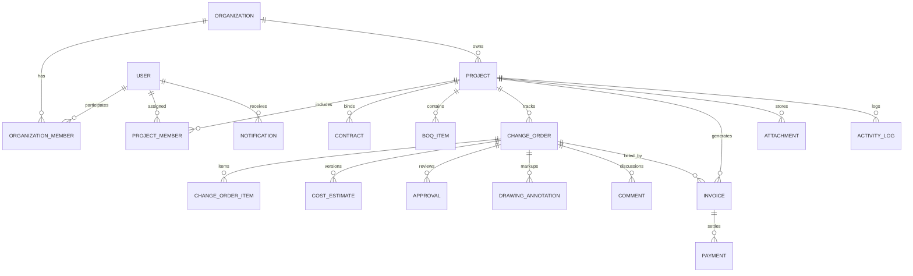

# AmendFlow — Database Design Specification

## 1. Overview & Data Modeling Strategy

AmendFlow uses MongoDB with Mongoose ODM to model a multi-tenant construction financial operations database. 
Key design principles:
- **Strict Multi-Tenancy:** Every organization-owned entity references `organization` (ObjectId). Compound indexes on `{ organization: 1, ... }` ensure query efficiency and tenant isolation.
- **Financial Precision:** All currency fields are stored as integer minor units (`Number`, representing paise) without floating-point storage.
- **Baseline Immutability:** Baseline BOQ records cannot be overwritten; changes are introduced strictly through approved Change Order revisions.
- **Audit Immutability:** Activity logs and formal approval sign-offs are append-only.

---

## 2. Entity-Relationship Model (Mermaid Diagram)

---

## 3. Detailed Collection Schemas

### 3.1 User (`users`)
Stores central user identities across organizations.

| Field | Type | Modifiers / Constraints | Description |
| :--- | :--- | :--- | :--- |
| `_id` | ObjectId | Primary Key | Unique user identifier |
| `name` | String | required, trim | Full legal name |
| `email` | String | required, unique, lowercase, index | Normalized user email |
| `passwordHash` | String | required | Salted bcrypt hash |
| `phone` | String | optional, trim | Contact telephone |
| `avatarUrl` | String | optional | Profile image URL |
| `activeOrgId` | ObjectId | ref: 'Organization', optional | Current active tenant workspace |
| `isEmailVerified` | Boolean | default: false | Email verification state |
| `resetToken` | String | optional | Hashed password reset token |
| `resetTokenExpiry`| Date | optional | Expiry time for reset token |
| `createdAt` | Date | default: now | Timestamp |
| `updatedAt` | Date | default: now | Timestamp |

---

### 3.2 Organization (`organizations`)
Top-level tenant boundary.

| Field | Type | Modifiers / Constraints | Description |
| :--- | :--- | :--- | :--- |
| `_id` | ObjectId | Primary Key | Unique organization identifier |
| `name` | String | required, trim | Company name (e.g. Northstar Infrastructure Pvt. Ltd.) |
| `legalEntityName`| String | optional, trim | Registered legal entity name |
| `taxId` | String | optional, trim | GSTIN / PAN / Corporate Tax ID |
| `currency` | String | default: 'INR' | Default operational currency |
| `address` | Object | optional | Street, city, state, postal code, country |
| `logoUrl` | String | optional | Organization corporate logo |
| `settings` | Object | default: {} | Default markups, overhead defaults, approval thresholds |
| `createdAt` | Date | default: now | Timestamp |
| `updatedAt` | Date | default: now | Timestamp |

---

### 3.3 OrganizationMember (`organization_members`)
Maps users to organizations with tenant-level RBAC.

| Field | Type | Modifiers / Constraints | Description |
| :--- | :--- | :--- | :--- |
| `_id` | ObjectId | Primary Key | Unique member record |
| `organization` | ObjectId | ref: 'Organization', required, index | Tenant reference |
| `user` | ObjectId | ref: 'User', required, index | User reference |
| `role` | String | enum: `owner`, `admin`, `project_manager`, `site_engineer`, `commercial_manager`, `finance_officer`, `client_approver` | Tenant-level authorization role |
| `status` | String | enum: `active`, `invited`, `suspended` | Membership state |
| `inviteToken` | String | optional | Pending invitation token |
| `createdAt` | Date | default: now | Timestamp |
| `updatedAt` | Date | default: now | Timestamp |

**Indexes:**
- Compound unique index: `{ organization: 1, user: 1 }`

---

### 3.4 Project (`projects`)
Construction contracts and physical site undertakings.

| Field | Type | Modifiers / Constraints | Description |
| :--- | :--- | :--- | :--- |
| `_id` | ObjectId | Primary Key | Unique project identifier |
| `organization` | ObjectId | ref: 'Organization', required, index | Tenant scope |
| `name` | String | required, trim | Project title |
| `code` | String | required, uppercase, trim | Unique project code (e.g., `PRJ-NSR-001`) |
| `description` | String | optional | Project description and scope summary |
| `clientName` | String | required, trim | Client firm name |
| `clientContact` | Object | optional | Name, email, phone of client lead |
| `contractorName`| String | required, trim | Appointed primary contractor entity |
| `location` | Object | required | Site address, city, state, coordinates |
| `startDate` | Date | required | Contract start date |
| `targetEndDate` | Date | required | Contractual completion date |
| `actualEndDate` | Date | optional | Physical handover date |
| `originalContractPaise`| Number | required, min: 0 | Baseline contract amount in paise |
| `currency` | String | default: 'INR' | Currency code |
| `status` | String | enum: `Planning`, `Active`, `On Hold`, `Completed`, `Archived` | Operational project status |
| `createdAt` | Date | default: now | Timestamp |
| `updatedAt` | Date | default: now | Timestamp |

**Indexes:**
- Compound unique index: `{ organization: 1, code: 1 }`
- Compound index: `{ organization: 1, status: 1 }`

---

### 3.5 ProjectMember (`project_members`)
Granular project assignment.

| Field | Type | Modifiers / Constraints | Description |
| :--- | :--- | :--- | :--- |
| `_id` | ObjectId | Primary Key | Project member ID |
| `project` | ObjectId | ref: 'Project', required, index | Assigned project |
| `user` | ObjectId | ref: 'User', required, index | Member user |
| `projectRole` | String | enum: `manager`, `engineer`, `estimator`, `finance`, `client_rep` | Role on this specific project |
| `assignedAt` | Date | default: now | Timestamp |

**Indexes:**
- Compound unique index: `{ project: 1, user: 1 }`

---

### 3.6 BOQItem (`boq_items`)
Contractual Bill of Quantities representing the immutable baseline schedule.

| Field | Type | Modifiers / Constraints | Description |
| :--- | :--- | :--- | :--- |
| `_id` | ObjectId | Primary Key | Item ID |
| `organization` | ObjectId | ref: 'Organization', required, index | Tenant scope |
| `project` | ObjectId | ref: 'Project', required, index | Associated project |
| `itemCode` | String | required, trim | Specification line number (e.g. `1.01.A`) |
| `description` | String | required, trim | Detailed specification description |
| `category` | String | enum: `Civil`, `Structural`, `MEP`, `Finishing`, `Infrastructure`, `External Works`, `General` | Category classification |
| `unit` | String | required, trim | Unit of measurement (`m2`, `m3`, `MT`, `nos`, `sqm`) |
| `baselineQuantity`| Number | required, min: 0 | Original contractual quantity |
| `unitRatePaise` | Number | required, min: 0 | Contract unit rate in integer paise |
| `baselineAmountPaise`| Number | required, min: 0 | `baselineQuantity * unitRatePaise` |
| `isLocked` | Boolean | default: true | True once baseline contract is signed |
| `notes` | String | optional | Baseline notes or specification clause |
| `createdAt` | Date | default: now | Timestamp |
| `updatedAt` | Date | default: now | Timestamp |

**Indexes:**
- Compound unique index: `{ project: 1, itemCode: 1 }`
- Compound index: `{ project: 1, category: 1 }`

---

### 3.7 ChangeOrder (`change_orders`)
The central entity representing a project modification, variation claim, or scope adjustment.

| Field | Type | Modifiers / Constraints | Description |
| :--- | :--- | :--- | :--- |
| `_id` | ObjectId | Primary Key | Change Order ID |
| `organization` | ObjectId | ref: 'Organization', required, index | Tenant scope |
| `project` | ObjectId | ref: 'Project', required, index | Target project |
| `orderNumber` | String | required, uppercase, trim | Formatted sequence (e.g., `CO-PRJ-001`) |
| `title` | String | required, trim | Concise modification title |
| `description` | String | required | Comprehensive description of variation |
| `category` | String | enum: `Additional Work`, `Omitted Work`, `Quantity Variation`, `Material Substitution`, `Design Modification`, `Time Extension`, `Other` | Type of modification |
| `priority` | String | enum: `Low`, `Medium`, `High`, `Urgent` | Urgency classification |
| `requestedBy` | ObjectId | ref: 'User', required | Requesting engineer or manager |
| `originatingParty`| String | enum: `Contractor`, `Client`, `Architect`, `Consultant`, `Site Condition` | Source of variation request |
| `requestDate` | Date | default: now | Date requested |
| `reason` | String | required | Commercial/technical root justification |
| `scheduleImpactDays`| Number | default: 0 | Proposed delay/extension in days |
| `totalProposedPaise`| Number | default: 0 | Current proposed charge to client in paise |
| `totalApprovedPaise`| Number | default: 0 | Final approved amount in paise |
| `status` | String | enum: `Draft`, `Submitted`, `Technical Review`, `Commercial Review`, `Internal Approval`, `Client Approval`, `Approved`, `Authorised for Execution`, `In Progress`, `Completed`, `Ready for Invoicing`, `Invoiced`, `Paid`, `Changes Requested`, `Rejected`, `Cancelled` | Lifecycle state |
| `unapprovedExecution`| Boolean | default: false | Flag: executed prior to client approval |
| `unapprovedJustification`| String | optional | Mandatory reason if executed unapproved |
| `unapprovedAuthorizedBy`| ObjectId | ref: 'User', optional | Manager who authorized unapproved execution |
| `activeEstimateId` | ObjectId | ref: 'CostEstimate', optional | Currently active cost estimate version |
| `createdAt` | Date | default: now | Timestamp |
| `updatedAt` | Date | default: now | Timestamp |

**Indexes:**
- Compound unique index: `{ project: 1, orderNumber: 1 }`
- Compound index: `{ organization: 1, status: 1 }`
- Compound index: `{ project: 1, status: 1 }`
- Compound index: `{ project: 1, unapprovedExecution: 1 }`

---

### 3.8 CostEstimate (`cost_estimates`)
Multi-line item cost calculation with versioned immutable snapshots.

| Field | Type | Modifiers / Constraints | Description |
| :--- | :--- | :--- | :--- |
| `_id` | ObjectId | Primary Key | Estimate ID |
| `changeOrder` | ObjectId | ref: 'ChangeOrder', required, index | Change order parent |
| `version` | Number | required, default: 1 | Revision version number |
| `isFrozen` | Boolean | default: false | True once formally submitted/approved |
| `items` | Array | [CostEstimateLineItem] | Sub-item lines (materials, labour, plant) |
| `directCostPaise`| Number | required, default: 0 | Sum of direct costs |
| `overheadPct` | Number | required, default: 10 | Overhead percentage (e.g. 10%) |
| `overheadPaise` | Number | required, default: 0 | Calculated overhead in paise |
| `markupPct` | Number | required, default: 15 | Profit markup percentage |
| `markupPaise` | Number | required, default: 0 | Calculated profit markup |
| `taxPct` | Number | required, default: 18 | GST / Sales Tax percentage |
| `taxPaise` | Number | required, default: 0 | Calculated tax in paise |
| `totalAmountPaise`| Number | required, default: 0 | Total proposed amount to client |
| `preparedBy` | ObjectId | ref: 'User', required | Estimator / Commercial Manager |
| `createdAt` | Date | default: now | Timestamp |

**Line Item Subschema:**
- `description`: String (required)
- `category`: `Material`, `Labour`, `Equipment`, `Subcontracting`, `Other`
- `quantity`: Number (required)
- `unit`: String (required)
- `unitRatePaise`: Number (required)
- `totalPaise`: Number (required, `quantity * unitRatePaise`)
- `boqItemRef`: ObjectId (ref: 'BOQItem', optional)

---

### 3.9 Approval (`approvals`)
Formal decision record in the multi-stage approval workflow.

| Field | Type | Modifiers / Constraints | Description |
| :--- | :--- | :--- | :--- |
| `_id` | ObjectId | Primary Key | Approval event ID |
| `changeOrder` | ObjectId | ref: 'ChangeOrder', required, index | Target change order |
| `stage` | String | enum: `Technical Review`, `Commercial Review`, `Internal Approval`, `Client Approval` | Approval checkpoint stage |
| `approver` | ObjectId | ref: 'User', required | Reviewing user |
| `decision` | String | enum: `Approved`, `Rejected`, `Changes Requested` | Formal outcome |
| `comments` | String | required | Evaluation rationale |
| `previousStatus`| String | required | State before this action |
| `newStatus` | String | required | State following this action |
| `signedAt` | Date | default: now | Immutable timestamp of decision |

---

### 3.10 DrawingAnnotation (`drawing_annotations`)
Vector visual markups over structural drawings and PDFs.

| Field | Type | Modifiers / Constraints | Description |
| :--- | :--- | :--- | :--- |
| `_id` | ObjectId | Primary Key | Annotation ID |
| `document` | ObjectId | ref: 'Attachment', required, index | Source PDF or Blueprint file |
| `changeOrder` | ObjectId | ref: 'ChangeOrder', optional, index | Associated change order |
| `pageNumber` | Number | required, default: 1 | Document page index |
| `type` | String | enum: `rect`, `marker`, `cloud`, `arrow`, `text` | Shape geometry type |
| `normalizedX` | Number | required (0.0 - 1.0) | Relative X offset on page |
| `normalizedY` | Number | required (0.0 - 1.0) | Relative Y offset on page |
| `normalizedWidth`| Number | optional (0.0 - 1.0) | Relative width |
| `normalizedHeight`| Number | optional (0.0 - 1.0) | Relative height |
| `color` | String | default: '#C53030' | Hex stroke/fill color |
| `label` | String | optional | Tag or sequence callout |
| `comment` | String | optional | Explanatory note |
| `createdBy` | ObjectId | ref: 'User', required | Authoring site engineer |
| `createdAt` | Date | default: now | Timestamp |

---

### 3.11 Invoice & Payment (`invoices`, `payments`)
Variation billing and receivables reconciliation.

**Invoice Fields:**
- `organization`: ObjectId (ref: 'Organization', required)
- `project`: ObjectId (ref: 'Project', required, index)
- `changeOrders`: [ObjectId] (refs: 'ChangeOrder', required)
- `invoiceNumber`: String (required, unique per project)
- `invoiceDate`: Date (required)
- `dueDate`: Date (required)
- `subtotalPaise`: Number (required)
- `taxPaise`: Number (required)
- `totalAmountPaise`: Number (required)
- `amountPaidPaise`: Number (default: 0)
- `balanceDuePaise`: Number (required)
- `status`: enum: `Draft`, `Issued`, `Partially Paid`, `Paid`, `Overdue`, `Cancelled`
- `notes`: String (optional)

**Payment Fields:**
- `invoice`: ObjectId (ref: 'Invoice', required, index)
- `paymentDate`: Date (required)
- `amountPaise`: Number (required, min: 1)
- `paymentMethod`: enum: `Bank Transfer`, `NEFT`, `RTGS`, `Cheque`, `Letter of Credit`
- `referenceNumber`: String (required, transaction reference)
- `recordedBy`: ObjectId (ref: 'User', required)
- `notes`: String (optional)

---

### 3.12 ActivityLog (`activity_logs`)
Append-only tamper-evident audit history.

| Field | Type | Description |
| :--- | :--- | :--- |
| `organization` | ObjectId | Tenant boundary |
| `project` | ObjectId | Project context (optional for org actions) |
| `entityType` | String | `Project`, `ChangeOrder`, `Estimate`, `Approval`, `Invoice`, `BOQ` |
| `entityId` | ObjectId | Reference to modified entity |
| `actor` | ObjectId | ref: 'User' (performer) |
| `action` | String | e.g., `CREATED`, `STATUS_CHANGED`, `APPROVED`, `PAYMENT_RECORDED` |
| `summary` | String | Human-readable audit description |
| `metadata` | Object | Prior & new values, diff payload |
| `ipAddress` | String | Performer IP address |
| `createdAt` | Date | Immutable event timestamp |
